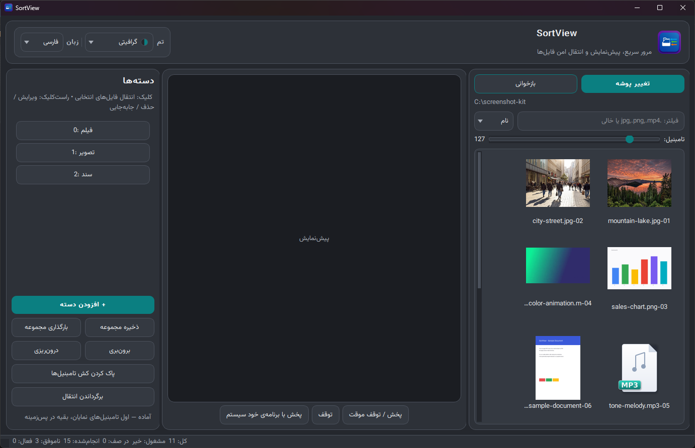
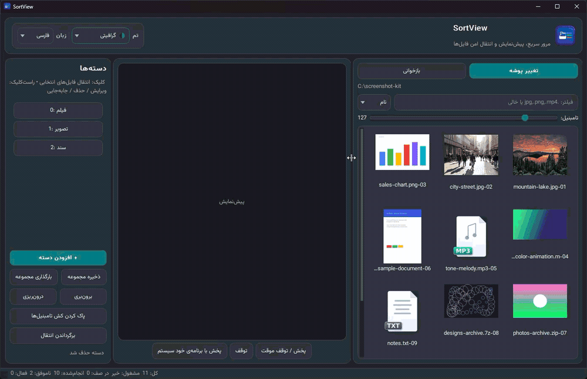
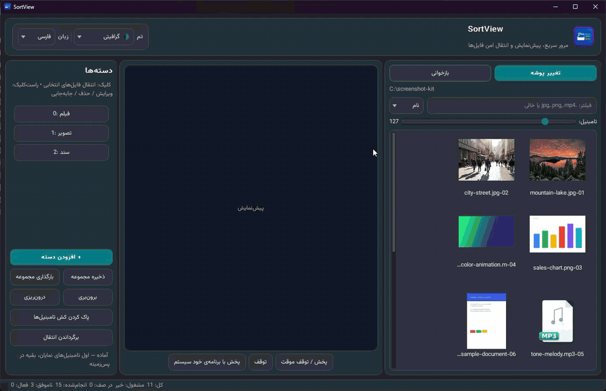
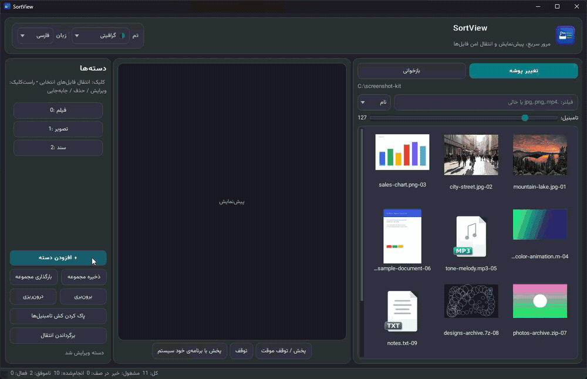

# سورت‌ویو (SortView) — مرورگر تامبنیل و مرتب‌کننده فایل برای ویندوز

هر پوشه‌ای را به یک گالری تامبنیل تبدیل کن، اول ببین هر فایل چیست، بعد با
یک کلید (۰ تا ۹) بفرستش سر دسته‌ی خودش.


**[دانلود آخرین نسخه ←](../../releases/latest)** — فقط یک فایل zip، بدون نصب.

[English](README.md) | **فارسی**

> **توجه:** خودِ برنامه‌ی سورت‌ویو و هر دو ردمی (انگلیسی و فارسی) با کمک
> هوش مصنوعی نوشته شده‌اند. اسکرین‌شات‌ها و گیف‌های دمو، تصاویر واقعی از
> خود برنامه هستند؛ فایل‌های نمونه‌ای که داخلشان دیده می‌شوند (تصاویر،
> نمودار، سند، کلیپ‌های صوتی و ویدیویی، آرشیوها و فایل‌های متنی/کد) با
> هوش مصنوعی ساخته شده‌اند.

## فهرست مطالب

- [چرا سورت‌ویو؟](#چرا-سورتویو)
- [دانلود و نصب](#دانلود-و-نصب)
- [شروع سریع](#شروع-سریع)
- [هشدار ایمنی](#هشدار-ایمنی)
- [امکانات](#امکانات)
- [کیبورد و ماوس](#کیبورد-و-ماوس)
- [فرمت‌های پشتیبانی‌شده](#فرمتهای-پشتیبانیشده)
- [سوالات متداول و مشکلات رایج](#سوالات-متداول-و-مشکلات-رایج)
- [داده‌های برنامه کجا ذخیره می‌شوند؟](#دادههای-برنامه-کجا-ذخیره-میشوند)
- [برای توسعه‌دهنده‌ها](#برای-توسعهدهندهها)
- [تغییرات](#تغییرات)
- [لایسنس و قدردانی](#لایسنس-و-قدردانی)

<p align="center">
  
</p>

## چرا سورت‌ویو؟

چون مرتب‌کردن صدها فایل توی اکسپلورر یعنی باز کردن تک‌تک فایل‌ها برای اینکه
بفهمی هر کدام چیست، و بعد کشیدن و رها کردنشان یکی‌یکی. سورت‌ویو همه‌چیز را
تامبنیل‌شده نشان می‌دهد: عکس‌ها، ویدیوها، صفحه‌ی اول PDFها و حتی اولین عکس
داخل فایل zip. فایل را نگاه می‌کنی، یک کلید عددی می‌زنی و همان لحظه می‌رود
سر جای خودش. برنامه از روی یک پوشه‌ی ساده اجرا می‌شود — بدون نصب — و هیچ
اتصالی به اینترنت ندارد؛ فایل‌هایت فقط روی کامپیوتر خودت می‌مانند.

## دانلود و نصب

1. برو به [صفحه‌ی Releases](../../releases/latest) و فایل
   `SortView-win64-portable.zip` را دانلود کن (و اگر خواستی درستیِ دانلودت
   را چک کنی، فایل `SortView-win64-portable.zip.sha256` را هم بگیر).
2. اختیاری — در PowerShell هش را بررسی کن:
   `Get-FileHash -Algorithm SHA256 SortView-win64-portable.zip`
   و با مقدار داخل فایل `.sha256` مقایسه‌اش کن.
3. فایل zip را هر جا که دوست داری باز کن — دسکتاپ، فلش و هر جا دیگر.
4. روی `SortView.exe` دابل‌کلیک کن. نه نصب می‌خواهد، نه پایتون، نه ffmpeg؛
   همه‌چیز داخل همان zip هست.

**پیش‌نیاز:** ویندوز ۱۰ یا ۱۱، ۶۴بیتی.

> **درباره‌ی هشدار SmartScreen:** اگر ویندوز پیام «Windows protected your
> PC» را نشان داد، روی **More info → Run anyway** کلیک کن. این هشدار برای
> همه‌ی برنامه‌های جدیدِ بدون امضای دیجیتال می‌آید؛ ساخت exe امضادار هزینه
> دارد و فعلاً این برنامه امضا ندارد. سورس کامل برنامه همین‌جا در همین
> ریپازیتوری است و در صفحه‌ی انتشار، فایل zip همراه یک فایل `.sha256`
> (هش SHA-256) گذاشته می‌شود تا بتوانی درستیِ دانلودت را چک کنی.

برای حذف برنامه هم فقط همان پوشه را پاک کن؛ همه‌ی تنظیمات و کش داخل همان
پوشه است و چیزی به رجیستری نوشته نمی‌شود.

## شروع سریع

1. روی **تغییر پوشه** کلیک کن و یک پوشه‌ی پر از فایل انتخاب کن.
2. روی هر فایل کلیک کن تا پیش‌نمایشش وسط صفحه بیاید.
3. با دکمه‌ی **+ افزودن دسته** هر تعداد دسته که می‌خواهی بساز (مثلاً عکس‌ها،
   ویدیوها، اسناد) — **هیچ محدودیتی** در تعداد دسته‌ها نیست. هر دسته یک دکمه
   در پنل کناری دارد: با **کلیک** فایل‌های انتخابی به آن دسته منتقل می‌شوند و
   با **راست‌کلیک** می‌توانی دسته را ویرایش یا حذف کنی یا جای‌اش را عوض کنی.
   فقط **ده دسته‌ی اول** شماره‌ی خودشان (`0` تا `9`) را روی دکمه‌شان نشان
   می‌دهند و به میان‌برهای کیبورد هم جواب می‌دهند.
4. یک فایل انتخاب کن و کلید شماره‌اش را بزن (`0` تا `9`). فایل **منتقل
   می‌شود** به پوشه‌ی آن دسته.

> **حواست باشد:** سورت‌ویو فایل را **منتقل** می‌کند (کپی نمی‌کند) — اما هر
> انتقال قابل برگشت است: درست بعد از انتقال، `Ctrl+Z` را بزن یا روی دکمه‌ی
> **برگرداندن انتقال** کلیک کن تا همان فایل‌ها به پوشه‌ی قبلی‌شان برگردند و
> دوباره در اکسپلورر دیده شوند. هیچ فایلی رونویسی نمی‌شود: اگر در مقصد فایل
> هم‌نام باشد، فایل منتقل‌شده خودکار نام جدید می‌گیرد (مثل `name (1).ext`).

<p align="center">
  
  <br><sub>همان مراحل بالا در حرکت: فایل‌ها را انتخاب کن، کلید عددی دسته را بزن — نوار وضعیت انتقال را خبر می‌دهد.</sub>
  <br><sub><b>درباره‌ی گیف‌ها:</b> گیف‌ها خیلی فشرده شده‌اند — فرمت گیف حداکثر ۲۵۶ رنگ دارد — برای همین ممکن است رنگ‌ها پله‌ای دیده شوند و
  موقع حرکت تامبنیل‌ها کمی جابه‌جا شوند. این خاصیت فرمت گیف است، نه سورت‌ویو؛ رنگ‌های خود برنامه پایدارند و با کیفیت کامل رندر می‌شوند.</sub>
</p>

## هشدار ایمنی

سورت‌ویو فایل‌های واقعی روی دیسک شما را جابه‌جا می‌کند. منطق انتقالش
محتاطانه طراحی شده — هیچ فایلی رونویسی نمی‌شود، انتقال هر لحظه قابل لغو
است و فایل مبدأ فقط بعد از تأیید کپی حذف می‌شود (بررسی حجم فایل کپی‌شده) — اما احتمال خرابی
کم است، نه صفر: قفل آنتی‌ویروس، درایو معیوب یا قطع برق وسط انتقال
همچنان می‌تواند یک فایل را خراب یا گم کند. **از سورت‌ویو برای فایل‌های
مهم استفاده نکن — یا اول از آن‌ها نسخه‌ی پشتیبان داشته باش تا اگر
فایلی پاک شد، هنوز نسخه‌اش پیشت باشد.** امن‌ترین راه شروع، تمرین روی
یک کپی از پوشه است؛ وقتی به برنامه اعتماد کردی سراغ فایل‌های اصلی برو.
مثل هر برنامه‌ی GPL-3.0، سورت‌ویو هم **بدون هیچ ضمانتی** ارائه می‌شود —
[`LICENSE`](LICENSE) را ببین.

## امکانات

- **گرید تامبنیل سریع** — فایل‌های جلوی چشم اول تامبنیل می‌گیرند و بقیه در
  پس‌زمینه؛ حتی با چند هزار فایل پنجره قفل نمی‌شود. با اسلایدر اندازه‌ی
  کاشی‌ها را عوض کن.
- **چیدمان سه‌پنلی با اندازه‌ی دلخواه** — بین اکسپلورر، پیش‌نمایش و پنل
  دسته‌ها خط جداکننده هست؛ آن را بکش تا هر پنل هر چقدر لازم داری جا بگیرد —
  مثلاً برای تماشای ویدیو پیش‌نمایش را پهن‌تر کن.

  <p align="center">
    
    <br><sub>کشیدن خط جداکننده: هر سه پنل به‌صورت زنده تغییر اندازه می‌دهند.</sub>
  </p>
- **پیش‌نمایش واقعی** — عکس، GIF متحرک، صفحه‌ی اول PDF؛ ویدیوها داخل پنجره
  پخش می‌شوند و به محض انتخاب شروع می‌شوند؛ فایل‌های صوتی (mp3، wav، flac
  و ...) هم صدایشان پخش می‌شود.
- **دکمه‌های پخش که واقعاً کار می‌کنند** — پخش/توقف موقت و توقف از وضعیت
  واقعی پخش‌کننده پیروی می‌کنند، ویدیو تا وقتی خودت نگویی تکرار می‌شود و
  دکمه‌ی «پخش با برنامه‌ی خود سیستم» هر وقت بخواهی فایل را به پخش‌کننده‌ی
  خودت می‌دهد.
- **دسته‌ها با کلیدهای عددی** — هر تعداد دسته که بخواهی بساز؛ ده دسته‌ی اول
  با کلیدهای `0` تا `9` کیبورد هم کنترل می‌شوند و با **راست‌کلیک** روی دکمه‌ی
  هر دسته می‌توانی ویرایش/حذف/جابه‌جایی‌اش کنی؛ وقتی در یک فیلد متنی
  می‌نویسی اعداد عادی تایپ می‌شوند و نگه‌داشتن کلید هم چند بار انتقال
  نمی‌سازد.

  <p align="center">
    
    <br><sub>ساخت، تغییر نام و حذف یک دسته — راست‌کلیک روی دکمه‌ی هر دسته برای ویرایش، حذف یا جابه‌جایی.</sub>
  </p>
- **انتخاب گروهی** — انتخاب معمولی با Ctrl و Shift؛ یعنی با یک کلید، ده
  فایل را با هم جابه‌جا کن.
- **فیلتر و مرتب‌سازی** — فقط `.jpg,.png,.mp4` را نشان بده (یا هر لیست
  پسوند دیگری)، مرتب‌سازی بر اساس نام یا نوع، و در صورت نیاز اسکن
  زیرپوشه‌ها.
- **انتقال امن** — هیچ فایلی رونویسی نمی‌شود، انتقال‌ها با نوار پیشرفت در
  پس‌زمینه انجام می‌شوند و هر لحظه قابل لغو هستند.
- **برگشت انتقال (Undo)** — فایل را اشتباهی فرستادی؟ با `Ctrl+Z` یا دکمه‌ی
  **برگرداندن انتقال** فایل‌های آخرین دور انتقال به پوشه‌ی قبلی‌شان
  برمی‌گردند (حتی اگر نامشان خودکار عوض شده باشد) و پوشه دوباره اسکن
  می‌شود تا در اکسپلورر دیده شوند.
- **فارسی و انگلیسی** — کل رابط با یک کلیک بین دو زبان عوض می‌شود (در
  فارسی چیدمان هم‌زمان راست‌به‌چپ می‌شود) و انتخابت حفظ می‌شود.
- **۶ تم متمایز** — روشن، کاغذی، گرافیتی، تیره، جنگلی، مشکی خالص — که از یک
  دراپ‌داون جمع‌وجور با دایره‌ی رنگی برای هر تم انتخاب می‌شوند و روی همه‌ی
  پنجره‌ها و دیالوگ‌ها و حتی نوار عنوان خود ویندوز اعمال می‌شوند.
- **کاملاً پرتابل** — تنظیمات و کش و لاگ همه کنار خود exe هستند؛ پوشه را
  پاک کنی، برنامه کامل حذف شده است.

## کیبورد و ماوس

| کار | ورودی |
|---|---|
| انتقال فایل(های) انتخابی به دسته‌ی شماره N | کلید عددی `0` تا `9` (ده دکمه‌ی سریع اول را کنترل می‌کند) |
| انتقال با ماوس | کلیک روی دکمه‌ی سریع شماره‌دار |
| ویرایش / حذف / جابه‌جایی یک دسته | راست‌کلیک روی دکمه‌ی آن دسته |
| برگرداندن آخرین انتقال | `Ctrl+Z` یا دکمه‌ی «برگرداندن انتقال» |
| انتخاب چند فایل | Ctrl + کلیک، Shift + کلیک |
| پخش / توقف موقت ویدیو و صدا | دکمه‌ی «پخش / توقف موقت» |
| توقف پخش | دکمه‌ی «توقف» |
| پخش در برنامه‌ی خودت | دکمه‌ی «پخش با برنامه‌ی خود سیستم» |
| باز کردن فایل با برنامه‌ی پیش‌فرض | دابل‌کلیک |

## فرمت‌های پشتیبانی‌شده

| گروه | پسوندها |
|---|---|
| ویدیو | mp4, mkv, avi, mov, webm, wmv, flv, mpeg, mpg, m4v, ts |
| صدا | mp3, wav, flac, aac, ogg, opus, m4a, wma |
| عکس | png, jpg, jpeg, bmp, webp, tiff, jxl, gif (متحرک) |
| آرشیو | zip, rar, 7z, tar, gz |
| سند | pdf, txt, md, doc(x), xls(x), ppt(x), epub |
| زیرنویس | srt, ass, ssa, vtt, sub, idx |
| کد | py, js, ts, html, css, json, xml, yaml, c/cpp, go, php, rb, java, rs, ... |

هر فرمت دیگری هم یک کارت نوع تمیز می‌گیرد تا گرید مرتب بماند.

## سوالات متداول و مشکلات رایج

**ویندوز پیام «Windows protected your PC» داد و اجازه‌ی اجرا نداد.**
exe هنوز امضای دیجیتال ندارد (گواهی امضا هزینه دارد). روی **More info →
Run anyway** کلیک کن. سورس کامل برنامه در همین ریپازیتوری است و در صفحه‌ی
انتشار، فایل zip همراه فایل `.sha256` آن قرار دارد.

**یک ویدیو پخش نمی‌شود.**
سورت‌ویو ویدیو و صدا را با موتور چندرسانه‌ای Qt پخش می‌کند که داخل خود
PyQt6 هست (بک‌اند FFmpeg هم داخل همان است) — چیز دیگری لازم نیست. اگر فایلی
باز نشد (کدک نادر)، نوار وضعیت دقیقاً می‌گوید مشکل چیست — یا روی
**پخش با برنامه‌ی خود سیستم** کلیک کن.

**تامبنیل فایل rar نمی‌آید.**
تامبنیل RAR به ابزار unrar خارجی نیاز دارد که ویندوز خودش ندارد؛ فایل‌های
zip و 7z بدون هیچ ابزار اضافه‌ای اولین عکس داخلشان را نشان می‌دهند.

**فایل را اشتباهی به یک دسته فرستادم.**
`Ctrl+Z` را بزن یا روی دکمه‌ی «برگرداندن انتقال» کلیک کن — فایل‌های آخرین
انتقال به پوشه‌ی قبلی‌شان برمی‌گردند (با نام اصلی‌شان، حتی اگر نامشان خودکار
عوض شده باشد) و دوباره در اکسپلورر نشان داده می‌شوند. تاریخچه‌ی برگشت فقط در
حافظه نگه داشته می‌شود: ۵۰ دور آخر را به یاد دارد و با بستن سورت‌ویو پاک
می‌شود. برای انتقال‌های قدیمی‌تر، پوشه‌ی دسته را باز کن و فایل را دستی برگردان.

**پایتون یا نرم‌افزار دیگری لازم است؟**
برای exe پرتابل نه — این دقیقاً فلسفه‌ی آن فایل است. پایتون فقط برای اجرا
از سورس لازم است (بخش توسعه‌دهنده‌ها در پایین صفحه).

**برنامه به اینترنت وصل می‌شود؟**
نه. خود برنامه هیچ اتصال شبکه‌ای برقرار نمی‌کند. (موتور چندرسانه‌ای همراهش
وابستگی داخلی به‌نام QtNetwork را لود می‌کند، اما برنامه با آن هیچ اتصالی
باز نمی‌کند.) دانلود فقط در اسکریپت‌های ساخت اتفاق می‌افتد که مخصوص
توسعه‌دهنده‌هاست.

## داده‌های برنامه کجا ذخیره می‌شوند؟

همه‌چیز کنار exe و داخل یک پوشه است:

```text
SortView.exe
user_data\
  config.json        <- تنظیمات (پوشه‌ی آخر، دسته‌ها، تم، زبان، ...)
  thumbs\            <- کش تامبنیل (پاک کردنش بی‌خطر است، دوباره ساخته می‌شود)
  category_sets\     <- مجموعه‌های دسته‌ی ذخیره‌شده
  app.log            <- لاگ خطاها
```

حذف برنامه یعنی پاک کردن همان پوشه؛ هیچ‌چیز به رجیستری نوشته نمی‌شود.

## برای توسعه‌دهنده‌ها

### اجرا از سورس

```bash
pip install -r requirements.txt
python main.py            # یا run.bat در ویندوز
```

پایتون ۳.۱۰ یا جدیدتر، ۶۴بیتی. برای پخش‌کننده‌ی داخلی ویدیو و صدا
`PyQt6>=6.9` لازم است (ویرایش‌های قدیمی موتور چندرسانه‌ای ندارند).
**فقط PyQt6 تست و پشتیبانی می‌شود** — در سورس، مسیر جایگزین PySide6/PyQt5
هست تا برنامه روی سیستم‌های دیگر هم بالا بیاید، ولی این مسیرها تست
نشده‌اند و مشکل‌های آن‌ها خارج از محدوده است. برای بیلد تکرارپذیر،
`BUILD.bat` در صورت وجود `requirements-lock.txt` همان نسخه‌های دقیقِ
تست‌شده را نصب می‌کند. هر نسخه قبل از انتشار با یک چک‌لیست پیش از انتشار
کنترل می‌شود (تامبنیل تصویر/PDF/آرشیو/ویدیو، انتقال و برگشت Undo).

### ساخت exe پرتابل

روی سیستمی که اینترنت دارد:

```bat
DOWNLOAD_PORTABLE_DEPS.bat   :: دانلود ffmpeg با نسخه و هش ثابت داخل bin\ (تامبنیل ویدیو)
BUILD.bat                    :: ساخت dist\SortView\ و SortView-win64-portable.zip (+ فایل .sha256)
```

پوشه‌ی `bin\` در ریپازیتوری نگه‌داری نمی‌شود (چند صد مگابایت باینری شخص
ثالث است)؛ `build_deps.ps1` بار اول همه‌چیز را با هش SHA-256 ثابت‌شده
دانلود می‌کند. فایل `SortView-win64-portable.zip` را همراه فایل `.sha256`
تولیدشده در GitHub Releases منتشر کن.

### نکات فنی

- **انتقال فایل‌ها:** تا جای ممکن hardlink؛ در غیر این صورت کپی اختصاصی
  (با `O_EXCL` — هرگز روی فایل موجود رونویسی نمی‌کند) و بعد از موفقیت
  کامل کپی، حذف مبدأ؛ نام یکتا برای تکراری‌ها؛ اجرا بیرون از رشته‌ی UI و
  قابل لغو.
- **برگشت انتقال (Undo):** هر دور انتقال کامل‌شده به‌صورت جفت‌های
  (مبدأ، مقصد) فقط در حافظه ذخیره می‌شود (۵۰ دور آخر، با بستن برنامه پاک
  می‌شود)؛ برگشت آخرین دور را بیرون از رشته‌ی UI به پوشه‌ی قبلی می‌برد
  (بدون هیچ رونویسی) و پوشه را دوباره اسکن می‌کند تا فایل‌ها در
  گرید ظاهر شوند.
- **تامبنیل‌ها:** اول موارد روی صفحه، بعد تکه‌های زمانی پس‌زمینه؛ فریم
  ویدیو با یک فراخوان ffmpeg (برای کلیپ‌های خیلی کوتاه در ۰.۴ ثانیه و سپس
  روی اولین فریم هم تلاش می‌کند)؛ اولین عکس داخل zip/7z/tar با کتابخانه‌های
  خود پایتون (zipfile و py7zr و tarfile) و محافظ حجمی در برابر archive bomb.
- **موتور پخش:** Qt Multimedia (بک‌اند FFmpeg داخل خود PyQt6) ویدیو و صدا
  را پخش می‌کند؛ «پخش با برنامه‌ی خود سیستم» هم همیشه به‌عنوان راه خروج هست.
- **امنیت:** از eval/exec/shell=True استفاده نمی‌شود؛ همه‌ی فراخوان‌های
  زیرفرآیند با لیست آرگومان انجام می‌شوند (هرگز `shell=True`)؛ خود برنامه
  هیچ اتصال شبکه‌ای برقرار نمی‌کند.

### ساختار پروژه

```text
main.py             <- کل برنامه همین یک فایل است
app_i18n.py         <- جدول ترجمه‌ی فارسی/انگلیسی
assets\             <- آیکون برنامه + آیکون‌های نوع فایل (ساخته‌شده با هوش مصنوعی)
docs\               <- اسکرین‌شات‌ها و گیف‌های دموی ردمی
BUILD.bat           <- ساخت exe پرتابل + فایل SortView-win64-portable.zip (+ فایل .sha256)
build_deps.ps1      <- دانلود و بررسی هش ffmpeg
user_data\          <- در زمان اجرا ساخته می‌شود (تنظیمات، کش، لاگ)
```

## تغییرات

تاریخچه‌ی کامل تغییرات در [CHANGELOG.md](CHANGELOG.md)؛ نسخه‌ی فعلی
**۱.۱۰.۲** است (رفع باگ Undo و چند اصلاح ایمنی).

## لایسنس و قدردانی

حق نشر (C) ۲۰۲۶ Mohammad Jafari (mohammadjafari-dev)

این پروژه تحت لایسنس **GPL-3.0-or-later** منتشر شده — فایل
[`LICENSE`](LICENSE) را ببین. خلاصه: استفاده، مطالعه، تغییر و بازنشر این
برنامه آزاد است، اما نسخه‌های تغییرکرده هم باید با همان لایسنس و همراه
سورس منتشر شوند.

ساخته‌شده با PyQt6، PyMuPDF، FFmpeg و فونت وزیرمتن — هر جزء
لایسنس خودش را دارد؛ فهرست کامل با لینک‌ها در
[`THIRD_PARTY_NOTICES.md`](THIRD_PARTY_NOTICES.md). همه‌ی آیکون‌های نوع
فایل داخل `assets\` اثر اصلی و **ساخته‌شده با هوش مصنوعی** مخصوص
سورت‌ویو هستند — بدون پک آیکون شخص ثالث و بدون لوگوی برند.
