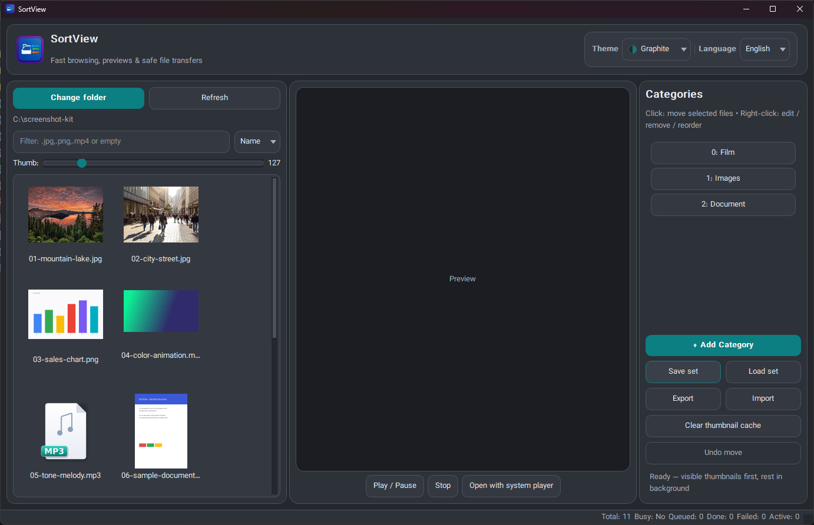
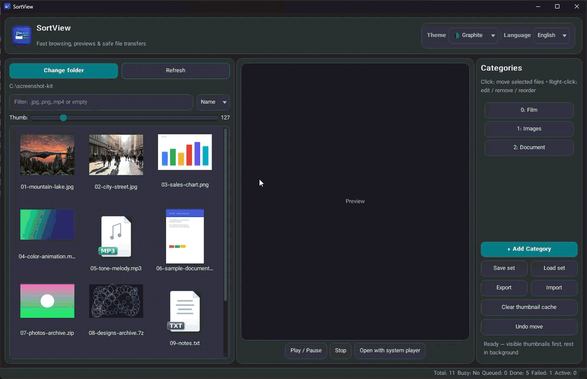
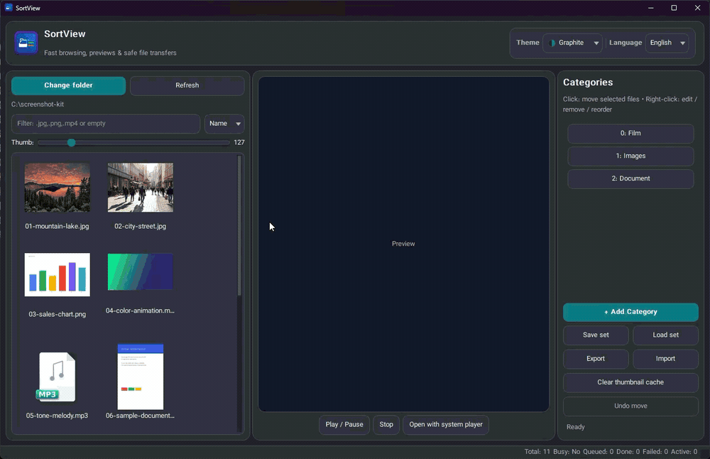
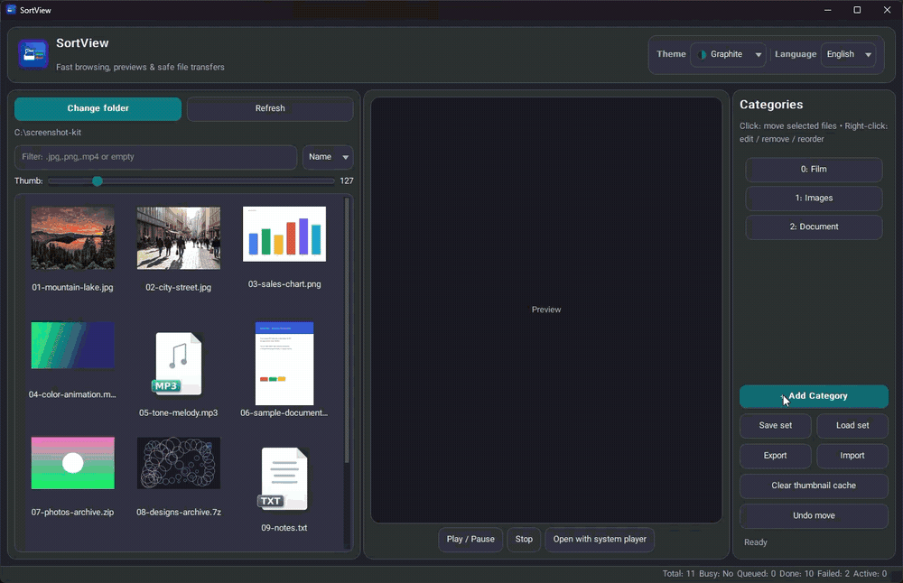

# SortView — Thumbnail Browser & File Sorter for Windows

Browse any folder as a thumbnail grid, see what every file actually is,
and sort it into your categories with one key press — `0`–`9`.


**[Download the latest release →](../../releases/latest)** — one zip, no installer.

**English** | [فارسی](README.fa.md)

> **Note:** SortView itself — and both READMEs (English and Persian) — were
> written with the help of AI. The screenshots and demo GIFs below are
> real captures of the actual application; the sample files shown inside
> them (pictures, chart, document, audio and video clips, archives, and
> small text/code files) were generated with AI.

## Contents

- [Why SortView?](#why-sortview)
- [Download & Install](#download--install)
- [Quick start](#quick-start)
- [Safety notice](#safety-notice)
- [Features](#features)
- [Keyboard & mouse](#keyboard--mouse)
- [Supported formats](#supported-formats)
- [FAQ & common problems](#faq--common-problems)
- [Where does SortView store its data?](#where-does-sortview-store-its-data)
- [For developers](#for-developers)
- [Changelog](#changelog)
- [License & credits](#license--credits)

<p align="center">
  
</p>

## Why SortView?

Because sorting thousands of files in Explorer means opening every file to
see what it is, then dragging it somewhere. SortView shows you everything as
thumbnails instead: images, videos, PDFs, even the first picture inside a
zip archive. You look at a file, press one number key, and it moves to the
right folder. It runs from a single folder — no installation — and it never
touches the network: your files stay on your PC.

## Download & Install

1. Go to the [Releases page](../../releases/latest) and download
   `SortView-win64-portable.zip`.
2. Optional — verify the checksum in PowerShell:
   `Get-FileHash -Algorithm SHA256 SortView-win64-portable.zip`
   and compare it with the SHA-256 value printed in the release notes —
   GitHub also displays the checksum right next to the asset.
3. Extract it anywhere — Desktop, a USB stick, whatever suits you.
4. Run `SortView.exe`. No installer, no Python, no ffmpeg, nothing else
   needed — everything is in the zip.

**Requirements:** Windows 10 or 11, 64-bit.

> **About the SmartScreen warning:** if Windows shows *"Windows protected
> your PC"*, click **More info → Run anyway**. The app is not code-signed
> yet, and Windows shows this warning for every new unsigned program. The
> complete source code is open right here in this repository, and the
> release page prints the SHA-256 checksum of the zip (GitHub also shows
> it next to the asset) so you can verify what you downloaded.

To uninstall, simply delete the extracted folder — the app keeps all its
settings and cache inside that folder.

## Quick start

1. Click **Change folder** and pick a folder full of files.
2. Click any file to preview it in the center panel.
3. Click **+ Add Category** and create as many categories as you like (e.g.
   Photos, Videos, Docs) — there is **no limit** on the number of categories.
   Every category appears as a button in the right panel: **click** it to move
   the selected files there, and **right-click** it to edit, remove or
   reorder it. Only the **first ten** categories also carry their number
   (`0`–`9`) and react to the matching keyboard shortcuts.
4. Select a file and press its number key (`0`–`9`). The file is **moved**
   into that category folder.

> **Heads-up:** SortView **moves** files (it never copies) — but every move
> can be undone: press `Ctrl+Z` or click the **Undo move** button right
> after a transfer and those files return to their original folder and
> reappear in the explorer grid. Files are never overwritten: if a file
> with the same name already exists in the destination, the moved file is
> renamed automatically (e.g. `name (1).ext`).

<p align="center">
  
  <br><sub>The flow above in motion: select the files, press the category's number key — the status bar reports the transfer.</sub>
  <br><sub><b>About the GIFs:</b> they are heavily compressed — a GIF stores at most 256 colors — so colors can look banded and drift
  slightly between frames while the thumbnails scroll. That is the GIF format, not SortView: the app's own colors are stable and
  rendered in full quality.</sub>
</p>

## Safety notice

SortView moves real files on your disk. Its transfer logic is designed to
be careful — files are never overwritten, transfers can be cancelled at
any moment, and a source file is deleted only after its copy has been
verified (a size check, not a full hash pass) — but the chance of
something going wrong is small, not zero: an antivirus lock, a failing
drive or a power cut in the middle of a transfer can still cost you a
file. **Do not use SortView on important
files — or keep a backup of them first, so if a file ever gets deleted
you still have it.** The safest way to start is on a copy of the folder;
sort the originals only once you trust the app. Like every GPL-3.0
program, SortView is provided **without any warranty** — see
[`LICENSE`](LICENSE).

## Features

- **Fast thumbnail grid** — visible files are thumbnailed first, the rest
  quietly in the background; the window never freezes, even with thousands
  of files. A slider adjusts the tile size.
- **Resizable three-panel layout** — the explorer, preview and category
  panels are separated by draggable dividers: widen the grid, give the
  preview more room for a video, or collapse it — the layout follows your
  mouse.

  <p align="center">
    
    <br><sub>Dragging the dividers: the grid, preview and category panels resize live.</sub>
  </p>
- **Real previews** — images, animated GIFs, PDF first pages; videos play
  inside the window and start as soon as you select them; audio files
  (mp3, wav, flac, ...) play their sound the same way.
- **Play controls that work** — Play/Pause and Stop follow the real player,
  videos loop until you stop them, and **Open with system player** hands
  the file to your usual player at any time.
- **Categories with number keys** — create as many categories as you want;
  the first ten are driven by the keyboard digits `0`–`9`, and **right-
  clicking** any category button lets you edit, remove or reorder it;
  digits behave normally while you are typing in a text field, and holding
  a key never repeats the move.

  <p align="center">
    
    <br><sub>Creating, renaming and removing a category — right-click any category button to edit, remove or reorder it.</sub>
  </p>
- **Multi-select** — standard Ctrl/Shift selection, so one key press can
  file ten files at once.
- **Filter and sort** — show only `.jpg,.png,.mp4` (or any extension list),
  sort by name or type, and optionally include subfolders in the scan.
- **Safe transfers** — files are never overwritten, transfers run in the
  background with a progress bar, and you can cancel them at any moment.
- **Undo** — moved something to the wrong category? `Ctrl+Z` (or the
  **Undo move** button) sends the files of the last transfer round back to
  their original folder — even after an automatic rename — and rescans the
  folder so they reappear in the explorer grid.
- **English & Persian (فارسی)** — the whole UI switches live between the two
  languages (Persian flips the layout right-to-left); the choice is
  remembered.
- **6 distinct themes** — Light, Paper, Graphite, Dark, Forest, AMOLED —
  chosen from a compact dropdown that shows a two-colour swatch for each,
  applied to every window, dialog, message box and even the Windows title
  bars.
- **Fully portable** — settings, thumbnail cache and logs live next to the
  exe; deleting the folder removes everything.

## Keyboard & mouse

| Action | Input |
|---|---|
| Move selected file(s) to category N | digit key `0`–`9` (drives the first ten quick buttons) |
| Move by mouse | click a numbered quick button |
| Edit / remove / reorder a category | right-click its button |
| Undo the last transfer | `Ctrl+Z` or the **Undo move** button |
| Select multiple files | Ctrl + click, Shift + click |
| Play / pause video & audio | `Play / Pause` button |
| Stop playback | `Stop` button |
| Play in your usual player | `Open with system player` button |
| Open file with the default app | double-click |

## Supported formats

| Group | Extensions |
|---|---|
| Video | mp4, mkv, avi, mov, webm, wmv, flv, mpeg, mpg, m4v, ts |
| Audio | mp3, wav, flac, aac, ogg, opus, m4a, wma |
| Images | png, jpg, jpeg, bmp, webp, tiff, gif (animated) |
| Archives | zip, rar, 7z, tar, gz |
| Documents | pdf, txt, md, doc(x), xls(x), ppt(x), epub |
| Subtitles | srt, ass, ssa, vtt, sub, idx |
| Code | py, js, ts, html, css, json, xml, yaml, c/cpp, go, php, rb, java, rs, ... |

Anything else gets a clean generated type card, so the grid stays readable.

## FAQ & common problems

**Windows showed "Windows protected your PC" and blocked the app.**
The app is not code-signed (signing certificates cost money). Click
**More info → Run anyway**. The full source code is in this repository, and
the release page prints the zip's SHA-256 checksum (GitHub shows it next
to the asset too).

**A video doesn't play.**
SortView plays video and audio through the Qt Multimedia engine that ships
inside the PyQt6 wheel (FFmpeg backend included) — nothing else is needed.
If a file cannot be decoded (a rare codec), the status bar tells you what
is wrong — or just click **Open with system player**.

**The sound of a video plays but the picture doesn't** (or vice versa)?
Same answer as above — try another engine via **Open with system player**,
and check that your system can play the file at all.

**No thumbnail for my .rar archive.**
RAR thumbnails need an external unrar tool that Windows doesn't ship; ZIP
and 7Z archives show their first picture without any extra tool.

**I moved a file to the wrong category.**
Press `Ctrl+Z` or click **Undo move** — the files of the last transfer are
moved back to their original folder (with their original name, even after
an automatic rename) and reappear in the explorer grid. The undo history
lives in memory: it remembers the last 50 transfer rounds and is cleared
when SortView closes. For older moves, open the category folder and move
the file back by hand.

**Do I need Python or any other software?**
Not for the portable exe — that's the whole point of it. Python is only
needed if you want to run the app from source (see below).

**Does the app connect to the internet?**
No. The app itself makes no network connections. (The media engine it
bundles technically loads QtNetwork as an internal dependency, but the app
never opens a connection with it.) Downloads only happen inside the
optional build scripts that developers run to compile the exe themselves.

## Where does SortView store its data?

Everything lives next to the exe, in one folder:

```text
SortView.exe
user_data\
  config.json        <- settings (last folder, categories, theme, language, ...)
  thumbs\            <- thumbnail cache (safe to delete, regenerates)
  category_sets\     <- saved category sets
  app.log            <- error log
```

Uninstalling = deleting the folder. Nothing is written to the registry.

Two exceptions worth knowing: if the folder SortView runs from is not
writable (e.g. the exe was launched from a read-only location), the whole
`user_data\` set is created in `%LOCALAPPDATA%\SortView\user_data\`
instead; and short-lived temporary files (video frames for thumbnails,
`7z` archive listings) go to the system `%TEMP%` folder and are cleaned
up when done.

## For developers

### Run from source

```bash
pip install -r requirements.txt
python main.py            # or run.bat on Windows
```

Requires Python 3.10+ x64. `PyQt6>=6.9` is required for the built-in media
player (older wheels lack the multimedia engine). **Only PyQt6 is tested
and supported** — the source contains PySide6/PyQt5 import fallbacks so it
still starts on other machines, but they are untested and issues against
them are out of scope. Reproducible builds: `BUILD.bat` installs
`requirements-lock.txt` (the exact tested versions) when present.

### Build the portable exe

On a build machine with internet access:

```bat
DOWNLOAD_PORTABLE_DEPS.bat   :: downloads the pinned ffmpeg.exe into bin\ (video thumbnails)
BUILD.bat                    :: builds dist\SortView\ + SortView-win64-portable.zip (+ .sha256)
```

`bin\` is not stored in the repository (an 87 MB third-party binary);
`build_deps.ps1` downloads it with a pinned SHA-256 hash on first run,
so a fresh clone builds out of the box. Distribute
`SortView-win64-portable.zip` through GitHub Releases — GitHub computes
and displays the SHA-256 of the uploaded asset automatically; keep the
generated `.sha256` file for local reference only.

### Technical notes

- **Transfers**: hardlink when possible; otherwise an exclusive copy
  (`O_EXCL`, can never overwrite); the source is deleted only after the
  copy passes a size check (not a full hash pass); unique names for
  collisions; runs off the UI thread, cancellable.
- **Undo**: completed transfer rounds are kept as (source, destination)
  pairs in memory (last 50 rounds, cleared on close); undo replays the
  newest round off the UI thread without ever overwriting anything and
  rescans the folder so the files reappear in the grid.
- **Thumbnails**: visible items first, then background time slices; video
  frames via one `ffmpeg` call (retries at 0.4 s and first frame for very
  short clips); first image inside zip/7z/tar via Python's own zipfile,
  py7zr and tarfile libraries with archive-bomb size guards.
- **Playback engine**: Qt Multimedia (the FFmpeg media backend inside the
  PyQt6 wheel) plays video and audio; **Open with system player** is the
  escape hatch for anything exotic.
- **Security**: no eval/exec/shell=True, all subprocess calls use list
  arguments (never `shell=True`), the app makes no network connections.

### Project structure

```text
main.py             <- the whole app
app_i18n.py         <- EN/FA translation table
assets\             <- app icon + AI-generated file-type icons
docs\               <- screenshots and demo GIFs for the README
BUILD.bat           <- builds the portable exe + SortView-win64-portable.zip (+ .sha256)
build_deps.ps1      <- downloads and hash-verifies ffmpeg
user_data\          <- created at runtime (settings, cache, logs)
```

## Changelog

All notable changes are documented in
[`CHANGELOG.md`](CHANGELOG.md) — the current release is
**v1.10.3** (a much slimmer portable build).

## License & credits

Copyright (c) 2026 Mohammad Jafari

This project is licensed under **GPL-3.0-or-later** — see
[`LICENSE`](LICENSE). In short: you are free to use, study, modify and
redistribute this app, but modified versions must also be released under
GPL-3.0 with their source code.

Built with PyQt6, PyMuPDF, FFmpeg and the Vazirmatn font —
every component keeps its own license; the full list with links is in
[`THIRD_PARTY_NOTICES.md`](THIRD_PARTY_NOTICES.md). All file-type icons and
cards in `assets\` are original artwork **created with AI** specifically
for SortView — no third-party icon sets and no brand logos.
